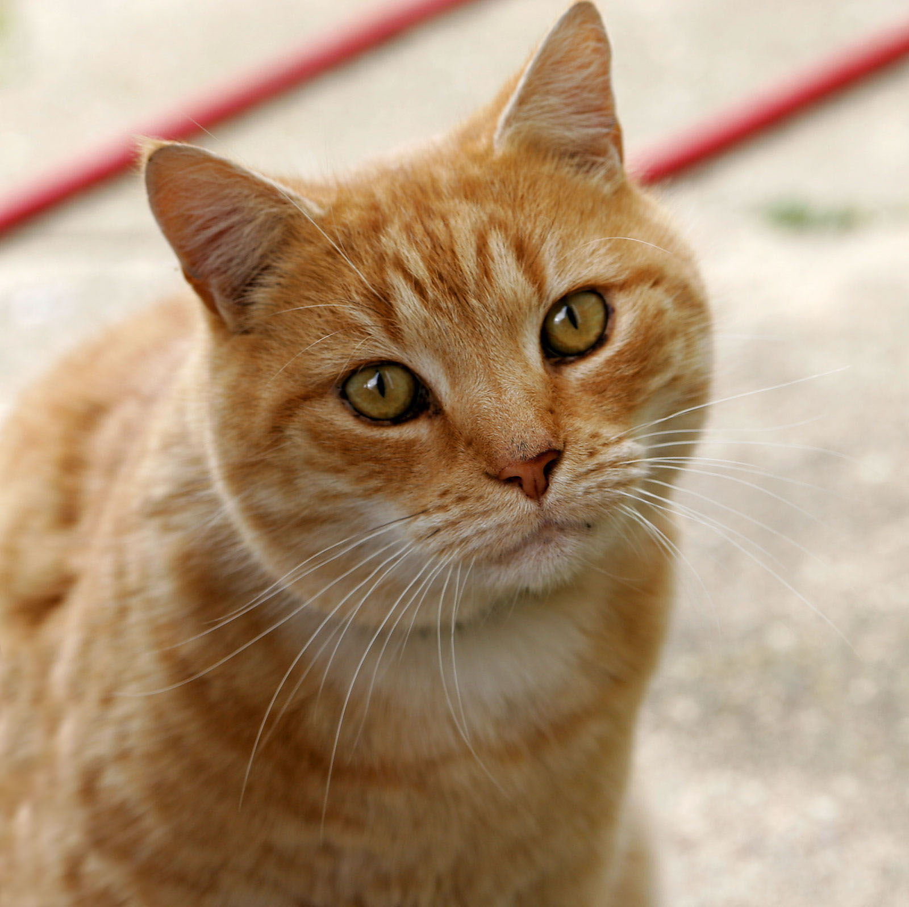

# Lab — Image Enhancer

Basic image enhancement tool using Pillow only. Applies manual factors for brightness, contrast, sharpness, and color.

## Supported Formats
- JPG / JPEG, PNG, WEBP, BMP, TIFF

## Requirements
```
pip install Pillow
```

## Usage
```bash
python image_enhancer.py <input_image> --output <output_image> --brightness 1.2 --contrast 1.5 --sharpness 2.0 --color 1.3
```

All factors default to `1.0` (no change):
- `--brightness`: >1 brighter, <1 darker
- `--contrast`: >1 more contrast
- `--sharpness`: >1 sharper
- `--color`: >1 more saturated, `0.0` = black & white

If `--output` is omitted, saves as `enhanced_<input_name>` next to the input.

## Examples
```bash
# Boost contrast + sharpness
python image_enhancer.py sample.jpg --output output_enhanced.jpg --contrast 1.5 --sharpness 2.0

# Warm it up with more color
python image_enhancer.py sample.jpg -o vivid.jpg --color 1.5 --brightness 1.1

# Black & white
python image_enhancer.py sample.jpg -o bw.jpg --color 0.0
```

## Sample File Used



## Sample Output
```
================================
IMAGE ENHANCEMENT REPORT
================================
Input           : sample.jpg
Size            : 1600x1598 px
Mode            : RGB
Brightness      : 1.0
Contrast        : 1.5
Sharpness       : 2.0
Color           : 1.3
Output          : output_enhanced.jpg
Done.
```
